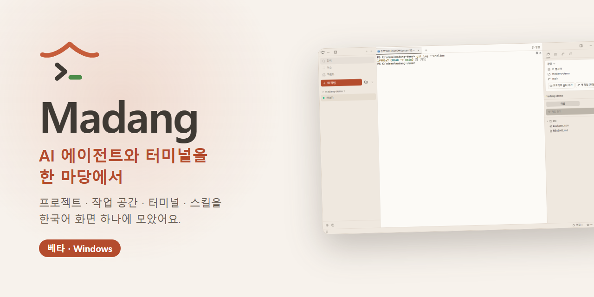
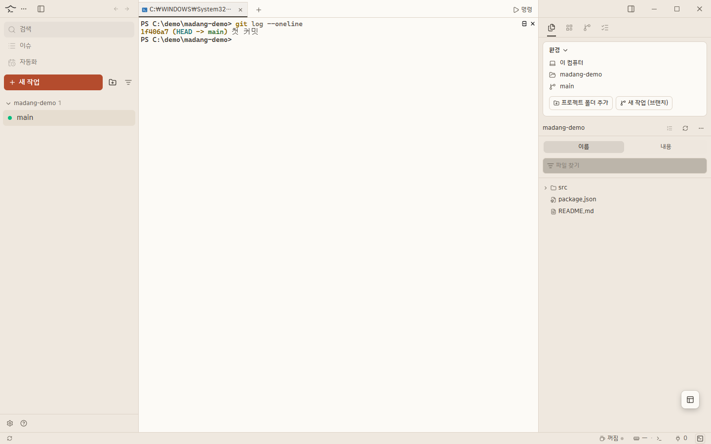
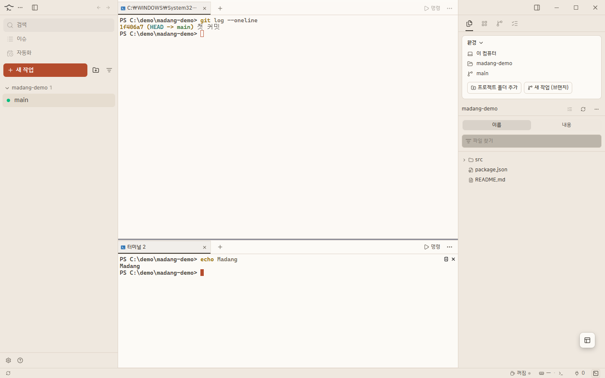
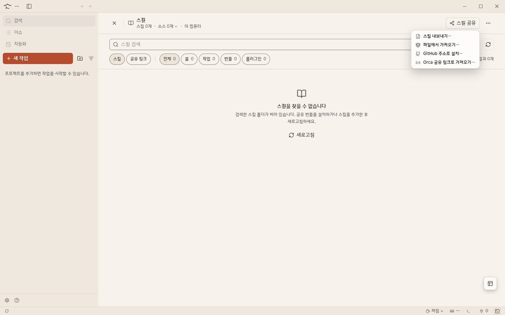
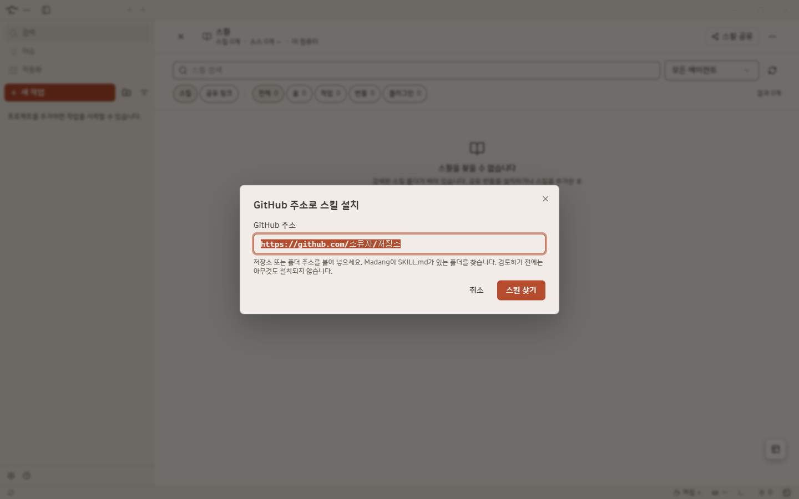
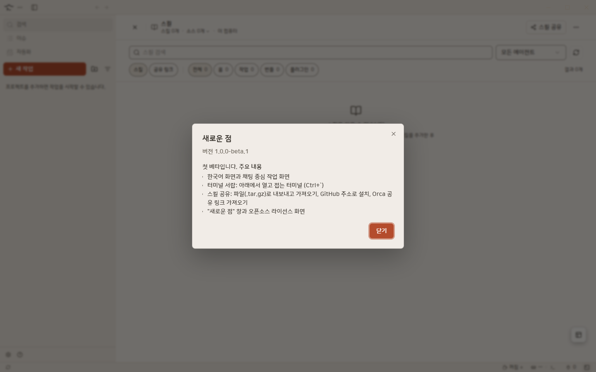
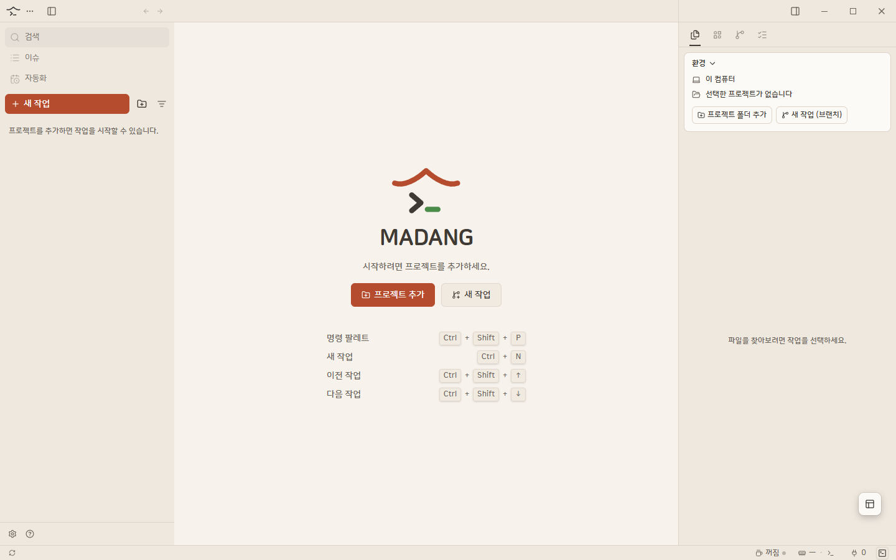
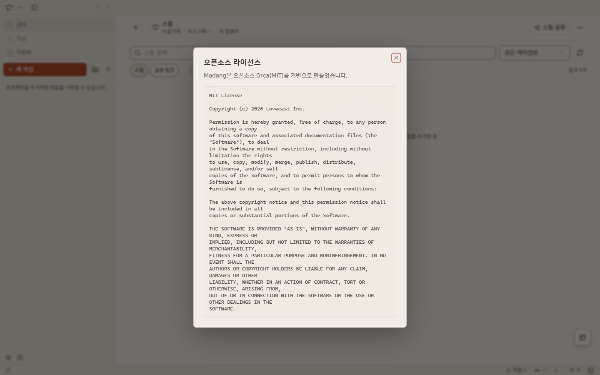

  

<h3 align="center">AI 코딩 에이전트와 터미널, 한 마당에서 다뤄요.</h3>

  프로젝트 · 작업 공간 · 터미널 · 스킬을 한국어 화면 하나에 모았어요. 
  <b>Orca(MIT)</b>를 기반으로 만든 Windows 데스크톱 앱이에요.

  
  
  

## ✨ 주요 기능

- 💬 **한국어 화면** — 메뉴·안내·오류 문구를 한국어로 보여 줘요
- 📁 **프로젝트와 작업 공간** — 프로젝트 폴더를 추가하고, 작업 공간을 만들어 나눠서 일해요
- ⌨️ **터미널** — 탭·분할, 그리고 아래에서 열고 접는 **터미널 서랍** (<kbd>Ctrl</kbd>+<kbd>`</kbd>). 접었다 열어도 같은 터미널이 그대로 있어요
- 🤖 **AI 에이전트** — 작업 공간마다 터미널을 열어 Claude·Codex 같은 에이전트를 실행해요
- 🧩 **스킬 공유** — 파일(`.tar.gz`)로 내보내고 가져오기, GitHub 주소로 설치, Orca 공유 링크 가져오기. 설치 전에 항상 내용을 확인하는 창이 떠요
- 🆕 **새로운 점** — 업데이트하면 바뀐 점을 앱에서 바로 보여 줘요
- 🎨 **마당 테마** — 크림색 바탕에 한옥 지붕색 포인트. 회색빛 테마도 고를 수 있어요
- 📜 **오픈소스 라이선스 화면** — 도움말 메뉴에서 전체 고지를 볼 수 있어요

  

<table>
  <tr>
    <td width="50%"> <b>터미널 서랍</b> · 아래에서 열고 접어도 같은 터미널</td>
    <td width="50%"> <b>스킬 공유</b> · 내보내기·가져오기·GitHub·Orca 링크</td>
  </tr>
  <tr>
    <td width="50%"> <b>GitHub 주소로 설치</b> · 주소만 넣으면 스킬을 찾아 줘요</td>
    <td width="50%"> <b>새로운 점</b> · 업데이트 뒤 첫 실행에 바뀐 점을 보여 줘요</td>
  </tr>
  <tr>
    <td width="50%"> <b>첫 화면</b> · 프로젝트를 추가하면 시작해요</td>
    <td width="50%"> <b>오픈소스 라이선스</b> · 도움말 메뉴에서 열어요</td>
  </tr>
</table>

더 자세한 설명은 **[사이트](https://dawnilove.github.io/Madang/)** 에서 볼 수 있어요.

## ⬇ 다운로드

**[madang-windows-setup.exe 바로 받기](https://github.com/Dawnilove/Madang/releases/download/v1.0.0-beta.1/madang-windows-setup.exe)** — 다른 버전은 [Releases](https://github.com/Dawnilove/Madang/releases)에 있어요.

- **Windows 10 / 11** — 설치 파일을 실행하면 끝나요. "PC 보호" 창이 뜨면 **추가 정보 → 실행**을 눌러 주세요. 이 베타는 코드 서명이 없어서 경고가 떠요
- **업데이트** — 베타는 자동 업데이트로 오지 않아요. 새 베타가 나오면 Releases에서 직접 받아 주세요
- **지원 환경** — 지금은 Windows용 설치 파일만 있어요

## 🐞 문제가 있나요?

[Issues](https://github.com/Dawnilove/Madang/issues)에 증상과 앱 버전을 적어 주세요.

## 📄 라이선스와 출처

Madang은 [Orca](https://github.com/stablyai/orca)(MIT 라이선스, Copyright (c) 2026 Lovecast Inc.)를 기반으로 만들었어요. 전체 고지는 앱의 도움말 → "오픈소스 라이선스"에서 볼 수 있어요.

이 저장소는 **배포 전용**이라 설치 파일과 안내만 있어요.
